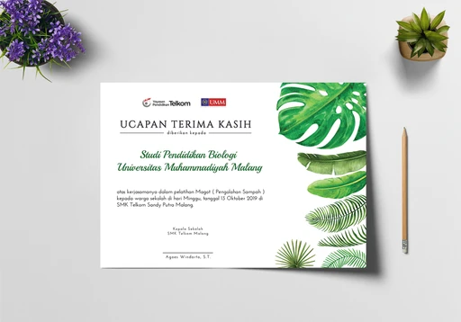
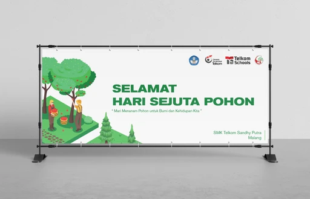

"Adiwiyata" is an effort to build a program or a good and ideal place to obtain knowledge and various norms and ethics that can be the basis of humans towards the creation of welfare for the ideals of sustainable development.

Thank you 🙏
