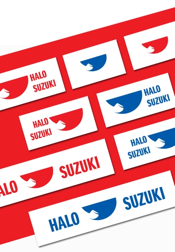
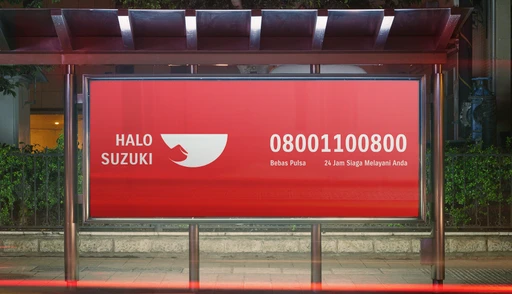
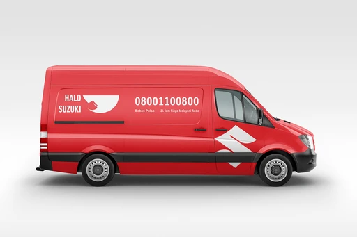
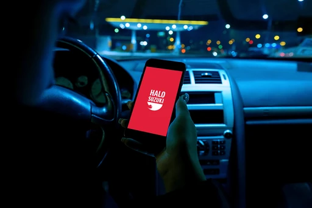
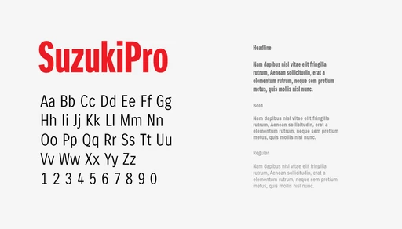

## Brand Identity

Users must have a happy feeling when they first see this logo. So here I made a strong logo, there are two hidden meanings in the Halo Suzuki logo: Smile and Telephone.

The semicircular attribute reflects someone who is smiling, namely the customers and waiters of hello Suzuki, giving the impression that the customer service of this service is user friendly so that the customer experience is very good and satisfied

Then the telephone silhouette gives the impression that the Halo Suzuki service is a telephone service, making it easier for users to find out what the Halo Suzuki service is

The choice of the main color red reflects the main color of the company logo Suzuki, and because red is the color with the highest wavelength, so it is easy to see from a distance, but I still provide the choice of blue, white and black, so that when promoted, there are no obstacles when the media place give the logo a color that doesn't match the red color.

## Promotion

You will never get a second chance to make a first impression. That applies to social communication and also for digital products. So I made this logo simple, but still firm, easy to recognize and still not renounce a philosophy that reflects Suzuki's own vision and mission.

Then with the right motive, this logo is flexible to be printed in small and large media

## Consistency & Strength

I care about Suzuki's identity policy standards, one of which is strength and consistency. Therefore, I provide the second element of the logo design that I made with the official font from Suzuki to maintain its identity as one of Suzuki's services.

