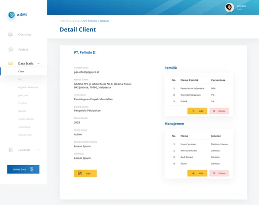
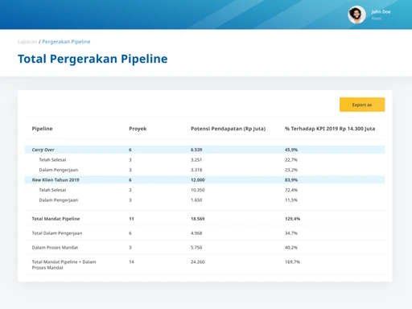
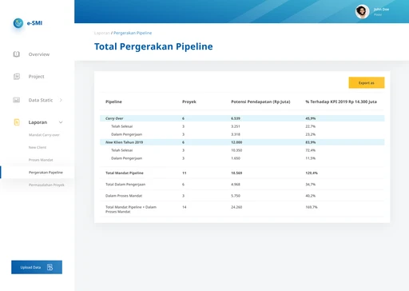
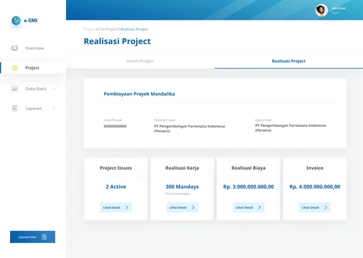

## Project Overview

Here's one of a few preproposal projects I collaborate to make with my UI/UX Designer team when I conduct an Intern at a Software House Company called DOT Indonesia.

## The Process

We were given a marvel prototype about what the client wants the app to look like, and then a spreadsheet filled with information about how this app works, etc.

On this occasion, our Team Design Lead made us (four UI/UX designer interns) as two teams that will design this app, so in the end, there will be two design styles to be presented at the proposal.

## Challenge

How to interpret the brief into a good design

My colleague and I spent a little time understanding the spreadsheet file, the flow, style and started digging inspiration before making the high fidelity design. It's quite a lot of screens we made because of how complex the sitemap of this app is, and not all of the screens I made myself, my colleague and I share the task 50/50, so here I will post a few screens that I made myself.

## What have I learned from this project?

I made a mistake in the design process. I didn't make an initial sketch as a first step to facilitate the creation of a user flow which I can later discuss with the team to understand between my thoughts and the team about the flow and features on this WebApp later.
